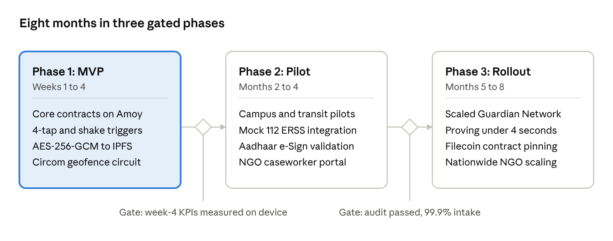

# She-Raksha Implementation Plan

Oct 31, 2026 · @MitiD

She-Raksha ships in three phases: a 4-week testnet MVP, a 3-month pilot, and a 4-month public rollout. Eight conflicts across the five documents must be settled before week 1, because each one changes a contract, schema or circuit.

## Decisions to settle before coding

| #   | Topic                      | What the documents say                                                                                                                    | Proposed resolution                                                                                                                                          |
| --- | -------------------------- | ----------------------------------------------------------------------------------------------------------------------------------------- | ------------------------------------------------------------------------------------------------------------------------------------------------------------ |
| 1   | e-FIR escalation timer     | PRD, SRS, ERD and ComplaintEscrow.sol use 72 hours (BNSS §173). DFD §3.1, §2.2 and the eFIRRecord sample use 48 hours.                    | Build 72 hours as the statutory timer. Treat 48 hours as an optional NGO early-warning notice, configurable per deployment.                                  |
| 2   | Shake trigger threshold    | SRS FR-SOS-001 and PRD: 2.5g. DFD 3.1: greater than 3.8G impact.                                                                          | Make the threshold a remote-config value. Default to 2.5g (the requirement) and test 3.8g as the impact-fall profile.                                        |
| 3   | Nullifier formula          | PRD and SRS: Poseidon(IdentitySecret, IncidentID). ERD: Poseidon(secret, Incident Epoch Bucket). DFD: Poseidon(sk, Geohash6, Salt).       | Use Poseidon(IdentitySecret, IncidentID) as in the SRS. It is the only one that gives one report per person per incident and unlinkability across incidents. |
| 4   | Spatial bucket for reports | ERD: H3 resolution 7 in a column named geohash_bucket, VARCHAR(6). DFD and SRS: geohash-6. DFD 3.4 uses H3 resolution 9 for guardians.    | Geohash-6 for anonymous reports (matches the circuit public input ttnf7z). H3 resolution 9 for guardian matching only. Rename the column to spatial_bucket.  |
| 5   | SMS fallback payload       | PRD risk table: 140-byte binary. DFD: Base91 in one 160-character GSM-7 segment.                                                          | Prototype the Base91 160-character form first. Keep the packet under 140 bytes before encoding so both fit.                                                  |
| 6   | Guardian table schema      | ERD query uses g.geom, but the guardians table has only current_geohash. Default radius_meters is 2000 while SRS and PRD say about 800 m. | Add a geom geography(Point) column. Dispatch uses 800 m; radius_meters stays the guardian's own response limit.                                              |
| 7   | Rail B recipients          | PRD: trusted contacts and ERSS-112. DFD: ERSS-112 shortcode only.                                                                         | Send to both: priority-ordered emergency_contacts first, then the ERSS-112 gateway.                                                                          |
| 8   | Brand colour tokens        | SRS §4.1 lists 4 tokens. The Brand Guide defines 10 (adds Electric Amber, Polygon Purple, Subtle Wire, three text neutrals).              | The Brand Guide is the source of truth. Export all tokens once as a shared package.                                                                          |

Two smaller fixes ride along: DFD §5.5 labels the PRD's 72-hour timer as 48 hours, and the ERD's sos_incidents.trigger_mode values (MANUAL_BUTTON, VOICE_DURESS, FALL_DETECTION, DEAD_MAN_SWITCH) differ from the DFD packet value HARDWARE_TAP_FOUR_PRESS. Keep one enum shared by the client, backend and schema.

## Architecture and repo layout

Build one TypeScript monorepo with nine packages, one per tier in the PRD stack table, so contracts, circuits and schemas are shared rather than copied between the app, PWA and backend.

| Package       | Tier                   | Stack (from PRD §6)                           | Owns                                                                                                  |
| ------------- | ---------------------- | --------------------------------------------- | ----------------------------------------------------------------------------------------------------- |
| contracts     | Smart contracts        | Solidity 0.8.24, Hardhat, OpenZeppelin        | EvidenceRegistry, ZKReportVerifier, ComplaintEscrow, SOSLog, GuardianRegistry, AccessGrant, Paymaster |
| circuits      | ZK engine              | Circom 2.1, SnarkJS, Groth16                  | Bystander circuit, trusted setup artifacts, generated Solidity verifier                               |
| backend       | Ingestion and relayers | Node.js (Fastify), PostgreSQL 16, PostGIS 3.4 | WebSocket hub, guardian matcher, Twilio and ERSS-112 relays, e-FIR timer worker                       |
| mobile        | Mobile client          | React Native (TypeScript), JSI, SQLCipher     | Triggers, multi-rail dispatch, capture and encryption, offline queue                                  |
| web           | Web client             | Next.js 14, Tailwind CSS, Service Workers     | Discreet PWA reporting, caseworker and police dashboard                                               |
| crypto-core   | Shared library         | TypeScript, WebCrypto                         | AES-256-GCM, HKDF, Merkle tree, SHA-256, Base91 packet codec                                          |
| sdk           | Shared library         | TypeScript, viem or ethers                    | ERC-4337 UserOperations, Web3Auth, Pinata client, contract bindings                                   |
| schemas       | Shared types           | JSON Schema, SQL migrations                   | The six data dictionary payloads (DFD §5) and ERD migrations                                          |
| design-tokens | Design system          | Tailwind preset, RN theme                     | Brand Guide colours, type scale, radii, status pills                                                  |

Data lives in four places, as the ERD defines: SQLCipher on the device (offline_queue, local_captures), IPFS and Filecoin for encrypted blobs, Polygon for hashes, nullifiers and escrow timers, and PostgreSQL with PostGIS for users, guardians, incidents, dispatch logs, e-FIR records and certificates.

Two rules from SRS §2.4 apply to every package and are enforced in CI: no personal data of any kind goes on-chain (hashes, nullifiers and Merkle roots only), and users never hold gas tokens (every write is a sponsored UserOperation).

## Workstreams

Seven workstreams cover all 20 functional requirements in the SRS (7 EV, 5 SOS, 4 ZK, 4 ID). Each row lists what to build first and the requirement IDs it closes.

| Workstream                 | Build in this order                                                                                                                                                                                                                                                                                              | Closes                                                         |
| -------------------------- | ---------------------------------------------------------------------------------------------------------------------------------------------------------------------------------------------------------------------------------------------------------------------------------------------------------------- | -------------------------------------------------------------- |
| 1\. Contracts              | Hardhat project on Polygon Amoy. EvidenceRegistry (anchorEvidence, verifyDigest), SOSLog, ComplaintEscrow (initEscrow, trigger72HrEscalation), then ZKReportVerifier with nullifier map, then GuardianRegistry, AccessGrant, Paymaster. Batch evidence into Merkle roots to hit 1 transaction per 1,000 records. | FR-EV-003, FR-SOS-005, FR-ZK-003, FR-ZK-004, NFR-SEC-004       |
| 2\. Identity and gasless   | Web3Auth MPC onboarding with passkeys, ERC-4337 smart account, bundler and Paymaster with monotonic nonces. Do this early: every other write depends on it.                                                                                                                                                      | FR-ID-001 to FR-ID-003, NFR-SEC-003                            |
| 3\. Evidence Vault         | crypto-core AES-256-GCM with a fresh 96-bit IV per 5-second chunk, SQLCipher local_captures, Pinata upload, SHA-256 and Merkle session root, anchor call. Overwrite plaintext buffers after encryption.                                                                                                          | FR-EV-001 to FR-EV-003, NFR-SEC-001, NFR-SEC-002, NFR-PERF-001 |
| 4\. Multi-rail SOS         | Trigger layer (4-tap power, accelerometer, TFLite audio), packet serializer, Rail A WebSocket with push, Rail B Twilio SMS, Rail C BLE advertising, then the SQLite offline queue with backoff and the PostGIS guardian matcher. Add the 5-second automatic drop from Rail A to Rail B.                          | FR-SOS-001 to FR-SOS-005, NFR-PERF-002, NFR-REL-002            |
| 5\. Anonymous reporting    | Circom circuit: identity commitment, jurisdiction membership, Poseidon nullifier. Trusted setup, generated verifier, SnarkJS proving in the app and PWA, relayer to the NGO queue.                                                                                                                               | FR-ZK-001 to FR-ZK-004, NFR-PERF-003                           |
| 6\. Legal pipeline         | Speech-to-text and BNS section classifier, e-FIR JSON generator, 72-hour timer worker with on-chain ComplaintEscrow mirror, §173(4) SP escalation petition, BSA §63 certificate pack (PDF/A-3 plus JSON-LD CID), e-sign flow with attribute redaction.                                                           | FR-EV-004 to FR-EV-007, FR-ID-004, NFR-REG-002, NFR-REG-003    |
| 7\. Design system and apps | Token package from the Brand Guide, then the React Native screens and Next.js PWA. SOS controls use at least 48 by 48 pt targets and distinct haptic patterns; every hash or CID renders as a monospace pill with an Emerald Shield check.                                                                       | SRS §4.1, Brand Guide §2 to §5                                 |

Build rules taken from the Brand Guide: Crimson Coral (#FF3B5C) appears only on SOS and critical actions, borders are 1px #222F3E with no heavy shadows, and copy follows the calm, direct voice (for example, "Evidence encrypted on-device. Digest anchored on Polygon L2.").

## Phase 1: MVP in four weeks

The MVP target is four things on Polygon Amoy: core contracts, the 4-tap and shake triggers, an encrypted capture-to-IPFS pipeline, and a first Circom circuit. Each week ends with a demo that exercises one full path.

1. **Week 1, foundations.** Resolve the eight decisions above. Create the monorepo, CI and design-tokens. Deploy EvidenceRegistry and SOSLog to Amoy. Stand up Postgres with PostGIS and the ERD migrations. Get Web3Auth passkey sign-in producing a smart account with sponsored transactions. _Demo: sign in, send one gasless anchor transaction._
2. **Week 2, evidence path.** Build crypto-core, the chunked AES-256-GCM encryptor, SQLCipher local_captures, Pinata upload and the Merkle session root. Anchor from the app. Add the Evidence Vault screen with CID and transaction pills. _Demo: record 30 seconds, see the CID and an on-chain digest that verifies._
3. **Week 3, SOS path.** Power-button and accelerometer listeners, packet serializer, WebSocket hub, Twilio SMS fallback with the 5-second timeout, SQLite offline queue, PostGIS guardian matcher, mock ERSS-112 relayer. BLE advertising prototype on Android. _Demo: switch on airplane mode, trigger SOS, watch the queue drain and SOSLog anchor on reconnect._
4. **Week 4, ZK and legal.** Circom circuit with the Poseidon nullifier and geofence membership, setup and verifier contract, SnarkJS proof in the app, duplicate-nullifier rejection. In parallel: e-FIR draft generator, 72-hour timer in ComplaintEscrow, first BSA §63 certificate. _Demo: two reports from one identity for one incident, the second rejected; an e-FIR with a running timer._

Exit criteria for week 4: the four primary KPIs in PRD §4 are measured on a mid-tier Android device, and any miss is logged with an owner.

## Phases 2 and 3

Phase 2 (months 2 to 4) moves from testnet demo to supervised pilot; Phase 3 (months 5 to 8) scales the guardian network and cuts proving time. Both follow PRD §7.

| Phase       | Window        | Deliverables                                                                                                                                                                                                                                                                                                                        | Gate to move on                                                                                                         |
| ----------- | ------------- | ----------------------------------------------------------------------------------------------------------------------------------------------------------------------------------------------------------------------------------------------------------------------------------------------------------------------------------- | ----------------------------------------------------------------------------------------------------------------------- |
| 2\. Pilot   | Months 2 to 4 | Campus and transit pilots with student cohorts; Mock 112 ERSS command-center integration; Aadhaar e-Sign validation through India Stack for legally binding complaints; production NGO caseworker portal with AccessGrant key delegation; Paymaster funding from several funders with refill alerts; mainnet deployment after audit | Contracts pass the NFR-SEC-004 coverage bar and an external audit; SOS intake runs at the 99.9% target during the pilot |
| 3\. Rollout | Months 5 to 8 | Scaled guardian network with volunteer incentives and credential attestations; circuit optimisation to under 4 seconds of proving time; Filecoin smart-contract pinning; nationwide NGO scaling; L2 state compression; BLE mesh expansion                                                                                           | Proving time under 4 seconds on mid-tier devices; 3-node replication (NFR-REL-003) verified on live data                |

The pilot sizing target in PRD §4 is about 4,482 verifiable incidents a year, which is 1% of the 4,48,211 registered crimes against women. Use it to size Pinata storage, Paymaster balance and the NGO review queue before the pilot starts.

## Quality gates

Every non-functional target in the SRS gets an automated check that runs in CI or on a device farm, so a miss blocks the release instead of surfacing in the pilot.

| Requirement  | Target                                                                                | How it is tested                                                                     |
| ------------ | ------------------------------------------------------------------------------------- | ------------------------------------------------------------------------------------ |
| NFR-PERF-001 | AES-256-GCM on a 50 MB payload in 2.0 s or less                                       | Benchmark on Moto g85 and Galaxy A15                                                 |
| NFR-PERF-002 | Trigger to socket dispatch in 500 ms or less                                          | Instrumented trigger-to-send timer on device                                         |
| NFR-PERF-003 | Groth16 proof in 8.0 s or less on mobile                                              | Proving benchmark on a Snapdragon 700-class phone; track toward the 4 s Phase 3 goal |
| NFR-PERF-004 | Anchor mined in 5.0 s or less on average                                              | Amoy and mainnet bundler latency log                                                 |
| NFR-REL-002  | Rail A timeout over 5.0 s falls back to SMS without user action                       | Fault injection: drop the socket and assert an SMS is sent                           |
| NFR-REL-003  | Pinned data on at least 3 distinct storage nodes                                      | Scheduled pin-status check on every CID                                              |
| NFR-SEC-002  | No plaintext evidence or location trail on unencrypted storage                        | Filesystem scan after a capture session                                              |
| NFR-SEC-004  | 100% line and branch coverage on EvidenceRegistry, ZKReportVerifier and the Paymaster | Hardhat coverage with a CI threshold                                                 |
| NFR-REG-001  | Key erasure makes IPFS ciphertext unrecoverable                                       | Delete keys, then attempt decryption of a pinned chunk                               |
| NFR-REG-002  | Digest and timestamp match IPFS content                                               | Verifier script run against each §63 pack                                            |

Add two tests the SRS does not list but its rules imply: a zero-PII scan of every contract call and event (SRS §2.4), and a replay test that submits a ZK proof twice and expects the nullifier check to reject it.

## Platform risks to test in week 1

Several spec promises depend on operating-system behaviour that the documents assume but do not confirm. Spike each one in week 1, because a failure changes the design. These are engineering judgments from the plan author, not statements from the five documents.

| Spec promise                                    | Concern                                                                                                                    | Spike and fallback                                                                                                                                                             |
| ----------------------------------------------- | -------------------------------------------------------------------------------------------------------------------------- | ------------------------------------------------------------------------------------------------------------------------------------------------------------------------------ |
| 4-tap hardware power button (FR-SOS-001)        | Android and iOS do not normally let a normal app intercept the power button.                                               | Spike an accessibility or foreground-service approach on Android. Fallback: volume-button or on-screen gesture trigger, and say so in the demo. iOS needs a different trigger. |
| Always-on offline audio classifier              | Continuous background microphone use is restricted, especially on iOS, and costs battery.                                  | Run the TFLite model inside a foreground service on Android, measure battery per hour, and ship it opt-in.                                                                     |
| Automatic SMS to contacts and ERSS-112 (Rail B) | Silent SMS sending is restricted on iOS and gated by permissions and store policy on Android; the Twilio route needs data. | Use the device SMS stack on Android where permitted. Keep Twilio for the connected case. Test the 5-second failover end to end.                                                |
| BLE mesh relay in the background                | Background advertising and scanning are limited, and the mesh only helps if other devices run the app.                     | Prototype foreground advertising first. Treat the mesh as best effort until the pilot has enough installed devices.                                                            |
| ZK proof in 8 s on mid-tier phones              | Browser WebAssembly proving can be slow and memory heavy.                                                                  | Benchmark the first circuit in week 4. Keep constraints small; move to native proving if the benchmark fails.                                                                  |
| Jurisdiction proof without exposing location    | The circuit needs jurisdiction boundary data in a form it can check.                                                       | Start with a coarse geohash-set membership check, and confirm with legal counsel what counts as presence.                                                                      |
| Statute text and timelines                      | Section numbers and deadlines (BNS §74, §75, §78; BNSS §173) drive the classifier and the timer.                           | Have counsel review the section mapping table and the 72-hour rule before the pilot.                                                                                           |

The PRD risk table already covers the offline blind spot, Paymaster depletion, evidence contestability, DPDP erasure and false SOS submissions; keep its mitigations as written.

## Roadmap

roadmap · 3 phases, 2 gates

The MVP runs four weeks. The pilot and rollout follow in months 2 to 4 and 5 to 8, and each opens only after the gate before it is met.